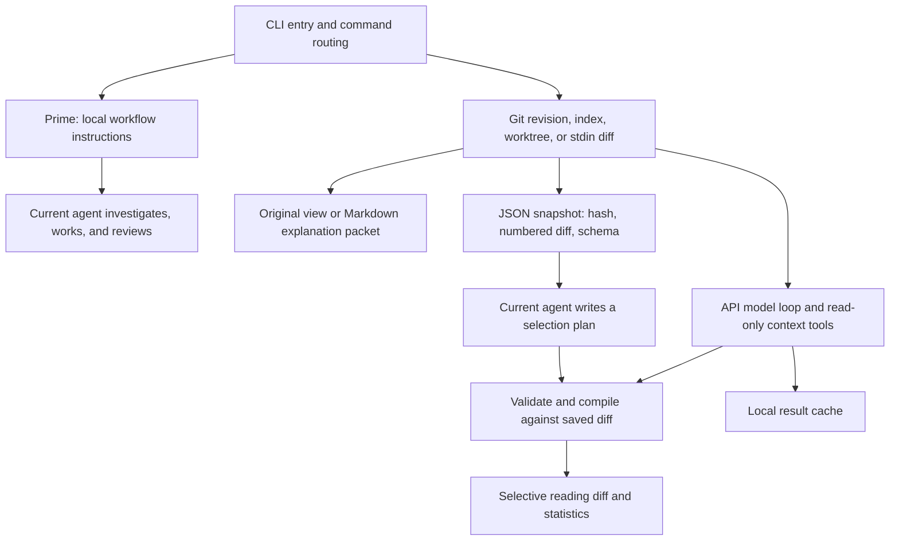

# columbo

**Understand unfamiliar code, make changes, and review them with evidence in your existing AI agent session.**

columbo gives Claude Code, Codex, and other agents a shared workflow for tracing
code, implementing requests, checking results, and handing work to the next
session. For large or repetitive diffs, it also provides a compiler that turns an
agent's selection plan into a smaller **reading diff**.

Start by telling your agent:

> Use columbo to explain how this project handles a request, from its entry point
> to its output. Cite the files you trace and identify anything you did not inspect.

The agent does the investigation. columbo supplies local instructions and tools.
There is no server to start, automatic review hook, or background agent scheduler.

Formerly **Thread** and **Meat**. The package is `columbo-review`; the `columbo`
and `meat` commands launch the same CLI. The instructions below install from this
checkout or a local package; no npm registry publication is assumed.

## What should I use?

| Your situation | Start with | What you get |
|---|---|---|
| You have an agent open and need to understand or change code | “Use columbo to…” | The current agent investigates, works, and reports evidence |
| You want to see a change without calling a model | `columbo -look HEAD` | Original diff, line counts, and a compact add/delete/context shape |
| You want your current agent to explain a change | `columbo -prompt HEAD` | Markdown containing the full diff and explanation instructions |
| A repetitive diff is hard to read | `columbo packet HEAD`, then `columbo compile …` | A snapshot-bound, compiler-validated reading diff from an agent-written plan |
| You want automatic API-based abridging | `columbo abridge -json -model MODEL HEAD` | Model/tool/compiler loop, with chunking and caching |
| You want a fresh signed-in CLI process to explain a change | `columbo -agent codex HEAD` or `columbo -agent claude HEAD` | Agent-authored prose using that CLI's subscription login |

`prime`, `-look`, `-prompt`, `packet`, and `compile` make **no model calls**.
An agent interpreting their output uses its normal model access. `-prompt`
exports the full diff; it does not shorten it. Plain `columbo HEAD` selects the
API abridger, so use an explicit command when choosing your access path.

## Install and try it without a model

You need **Git and Node 22.18+**. Node 24 is recommended by `.nvmrc`. Go is not
needed. From this checkout:

```sh
npm ci
npm run build
node dist/cli/main.js -look HEAD
node dist/cli/main.js prime understand
```

The first CLI command shows the latest commit's original diff and its shape.
The second prints instructions for your current agent to follow; it does not
inspect the repository itself.

To make `columbo` and `meat` available as shell commands:

```sh
npm link
columbo capabilities --json
```

All examples below use `columbo`. Without linking, replace it with
`node /absolute/path/to/meat/dist/cli/main.js`. Keep your shell in the repository
being examined: Git input and relative file paths come from that working directory.

### Enable the workflow in another project

After linking, go to the project where you want to use columbo:

```sh
cd /path/to/your-project
columbo setup --agent both
columbo setup --agent both --yes
```

The first command previews the exact files; the second installs the columbo,
Meat compatibility, and show-me skills. Choose `--agent codex` or `--agent claude`
for one host. Codex uses `.agents/skills/`; Claude Code uses `.claude/skills/`.
You can also select a project with `--project /path/to/your-project`.

Open a fresh agent session there and ask “Use columbo to explain this project.”
If skill discovery is stale, ask the agent to run `columbo prime understand --json`
and follow `data.instructions`. Installation alone does not register skills in
all your repositories.

Setup defaults to preview (`--dry-run`) and always returns JSON. Matching skills
stay unchanged. Differing files or unsafe symlinks block installation; inspect
`data.ready` and the listed paths. Preserve or move conflicts before retrying;
there is no force-overwrite option. A filesystem failure during installation can
leave partial new files, listed in the error for recovery.

Installed skills contain absolute Node and CLI launch paths. Keep that installation
available, and preview setup again after moving or upgrading it. Setup does not
change `AGENTS.md`, `CLAUDE.md`, host settings, or credentials.

### Share a local package with a teammate

From the columbo checkout:

```sh
npm run check
npm pack
```

`npm pack` builds the CLI and creates `columbo-0.1.0.tgz` for the current
package version. Give the archive to your teammate. They run:

```sh
npm install -g ./columbo-0.1.0.tgz
cd /path/to/their-project
columbo setup --agent both
columbo setup --agent both --yes
```

## Practical scenarios

These prompts are examples for your own repository. Their file names and desired
behavior should be adapted to your task; they are not claims about columbo's own
application features.

### 1. Join an unfamiliar project

**Situation:** You need to change an importer but do not know how its parts fit.

Ask your current agent:

> Use columbo to trace the CSV import flow from the CLI entry point through parsing,
> validation, and persistence. Read the project instructions and README first.
> Show the main modules and data flow, explain what happens on a malformed row,
> and cite the code and tests supporting your explanation. Do not edit files.

The agent can load `columbo prime understand`. Expect a source-backed explanation,
a small diagram when useful, and explicit gaps. This gives you a focused starting
point for a change.

For a broader investigation, ask:

> Use columbo to audit this repository for correctness. Map its architecture,
> trace the main execution paths, and report reproducible findings. Distinguish
> modules you traced, sampled, and did not inspect. Do not implement fixes yet.

That uses `columbo prime audit`. **Audit covers existing code; review covers a
selected change.** `packet HEAD` only packages the latest commit, not the repository.

### 2. Implement a change with clear completion criteria

**Situation:** An importer retries permanent failures and wastes time.

> Use columbo to change the importer so it retries transient network failures at
> most three times and immediately reports validation failures. Trace the current
> behavior first. Add appropriate tests for retry exhaustion and validation
> failure, run the relevant checks, and review the final diff. Explain any
> remaining risks with file references.

The agent loads `columbo prime work`, investigates, implements, verifies, and
reviews consequential changes. Expect the changed behavior, actual check results,
and unresolved issues. A small fix may only need the ordinary diff; a repetitive
change may benefit from compilation.

During work, ask “Where are we? What needs my attention?” You can also name a
relevant specialist skill in the same request. The agent loads that guidance;
Prime itself does not fetch skills or execute the task.

### 3. Understand or review a change before committing

**Situation:** You have staged changes and want to know what could break.

For a quick local view:

```sh
columbo -look -staged
```

For an explanation in your current agent session:

```sh
columbo -prompt -staged > /tmp/columbo-staged-review.md
```

Then ask:

> Read /tmp/columbo-staged-review.md and use columbo to review these staged changes.
> Inspect the original diff, relevant callers, and tests. Explain the behavior
> changes, report concrete defects with triggering conditions, and distinguish
> checks you ran from checks you recommend. Do not change files.

Expect findings tied to the inspected snapshot and source evidence. The Markdown
packet contains the full diff, its SHA-256, and its byte count. It does not contain
all surrounding source or prove that tests passed. In a session with repository
access, the agent can inspect the missing context.

Choose the right source before reviewing:

| Scope | Original view | JSON planning packet |
|---|---|---|
| Latest commit | `columbo -look HEAD` | `columbo packet HEAD` |
| Branch changes since its merge base with `main` | `columbo -look main...HEAD` | `columbo packet main...HEAD` |
| Staged changes | `columbo -look -staged` | `columbo packet --staged` |
| Unstaged tracked changes | `columbo -look -w` | `columbo packet --worktree` |
| Selected paths | `git diff -- src/cli/ \| columbo -look` | `git diff -- src/cli/ \| columbo packet --stdin` |

Replace `main` and the example path with your actual base branch and scope.
Staged and unstaged inputs are separate. Ordinary Git diffs omit untracked files;
stage specific new files when their contents should be included, or inspect them
separately and disclose that coverage.

### 4. Make a repetitive diff easier to read

**Situation:** A refactor moves functions and repeats the same mechanical edit
across many files. You want to see consequential changes without asking a model
to rewrite code from memory.

Run this from the target repository, keeping artifacts outside the reviewed diff:

```sh
review_dir=$(mktemp -d)
columbo packet HEAD > "$review_dir/packet.json"
printf '%s\n' "$review_dir"
```

Give the printed directory to your current agent:

> Read packet.json in that directory, including data.instructions,
> data.numbered_diff, data.plan_schema, and data.selection_rubric. Inspect relevant
> source. Start from data.plan_template and write plan.json beside the packet.
> Keep consequential behavior and uncertain changes; remove mechanical repetition.
> Use the packet's original numbered-diff coordinates. Compile the plan, repair
> rejected operations without modifying the packet, and explain the reading view
> alongside the original diff. Do not claim compilation proves correctness.

The compile command, using the same shell variable, is:

```sh
columbo compile --packet "$review_dir/packet.json" --plan "$review_dir/plan.json" > "$review_dir/result.json"
node -e 'const r=JSON.parse(require("node:fs").readFileSync(process.argv[1],"utf8")); if(!r.ok) { console.error(r.error); process.exit(1); } console.log(r.data.summary); console.log(r.data.smart_diff);' "$review_dir/result.json"
```

You get `data.summary`, `data.smart_diff`, transformation statistics, and explicit
guarantees and warnings. The agent selects what matters; the compiler checks the
allowed transformations against the saved diff. Plans use **1-based diff line
numbers**, not source-file line numbers. A packet and its plan can be compiled
outside the original checkout, with no provider credentials.

The result is a reading aid, **not an applyable patch**. Imports are always
removed. Valid compilation does not establish that the selection preserved every
important behavior; correctness review still needs the original diff and source.

### 5. Hand work from Claude Code to Codex, or resume tomorrow

**Situation:** One agent implemented a change and another will review or finish it.

Ask the implementing agent:

> Leave a columbo handoff for the next session. Include the repository path, goal,
> acceptance criteria, branch and HEAD, dirty and untracked files, relevant source,
> actual checks and results, open findings, and the next concrete action. Separate
> agreed work from optional ideas. Give me one self-contained prompt.

Then ask the next agent:

> Use this handoff to continue. Verify the current snapshot before trusting earlier
> results. Review the original diff and relevant source yourself, and recheck any
> findings affected by subsequent edits.

Expect an agent-written account of the actual state. columbo does not automatically
transfer conversation history or provide persistent memory. A separate reviewer
only adds independent evidence if it inspects the code itself; changing vendors
is optional.

### 6. Explain failure and recovery visually

**Situation:** A retry or cancellation path is difficult to reason about.

> Use columbo to show the importer as a statechart, including validation failure,
> transient failure, retries, cancellation, and recovery. Cite the code behind
> each important transition and identify assumptions or omitted behavior.

The agent follows the [statechart guide](prime/optional/statecharts.md), using
show-me when useful. Charts distinguish proposed behavior, implementation-traced
behavior, and actual model-checking results. columbo does not automatically extract
state machines or run a model checker.

## Preserve intent and evidence between sessions

columbo can now store explicit task intent, source-bound evidence, and decision
history locally in Git metadata. Start with:

```sh
columbo status --json
columbo snapshot --file src/cli/main.ts --json
columbo record-schema --json
```

`status` creates no files. `snapshot` hashes selected files without storing source
text. `columbo record --file RECORD.json` explicitly saves an immutable intent,
evidence claim, or decision. A later `status --task ID` identifies changed or
unavailable supporting files and unresolved decisions. Status defaults to a compact
summary; add `--details` to read full claims and decision history. Use the
[complete record examples](docs/cli-reference.md#local-intent-evidence-and-decisions)
to start a task and save evidence.

Claims remain attributed assertions. Unchanged hashes mean supporting bytes match;
they do not prove correctness or that tests ran. Decisions preserve reported human
judgment without granting execution permissions. State stays local to the worktree
and is not automatically shared through Git or loaded into every agent session.

## Optional model execution

### Automatic API abridging

When you explicitly want columbo to run the model/tool/compiler loop:

```sh
columbo abridge -json -model MODEL HEAD
```

Replace `MODEL` with an API model ID available to your account and configure the
appropriate provider key. `claude-*` routes to Anthropic, `grok-*` to xAI, and
other IDs to OpenAI. Large diffs can be chunked automatically. The engine can
request surrounding source through read-only file and search tools.
The diff and requested context are sent to the selected provider.

| Configuration | Meaning |
|---|---|
| `OPENAI_API_KEY`, `ANTHROPIC_API_KEY`, `XAI_API_KEY` | Credentials for the selected native provider |
| `COLUMBO_MODEL` | Default model; overrides `MEAT_MODEL`. Explicit `-model` wins |
| `COLUMBO_CACHE` | Cache directory; overrides `MEAT_CACHE`, including an empty value that disables caching |
| `OPENAI_BASE_URL`, `ANTHROPIC_BASE_URL`, `XAI_BASE_URL` | Provider endpoint overrides |
| `-no-cache` | Skip cached reads and recompute; still write the result to cache |

The default cache is `~/.meat`. Its key includes the diff, model, and rubric/compiler
identity; surrounding source is not part of that key. Recompute when changed
context makes a cached result inappropriate. columbo does not load `.env`
automatically; explicitly use `node --env-file=.env /absolute/path/to/dist/cli/main.js …`
when intended. Subscription logins are separate from API credentials. Gemini is
not a native provider. Supported exe.dev environments can use a managed gateway;
see [provider contracts](specs/providers.md).

### A fresh subscription CLI explanation

If the respective CLI is installed and signed in:

```sh
columbo -agent codex HEAD
columbo -agent claude HEAD
```

Choose one command. columbo checks subscription login and removes API-routing
credentials from the child environment; it does not fall back to API abridging.
The fresh process uses network access and subscription allowance. Its output is
an agent-authored explanation, not a compiled reading diff.

These runners are instructed not to modify files or run tests. Codex uses a
read-only sandbox; Claude is restricted to Read/Grep/Glob. Host CLI versions must
support the adapter flags. See [runner details and verification limits](docs/agent-workflow.md).
For implementation and test execution, use your normal current agent session.

## How columbo is built

The active implementation is a TypeScript CLI with no production npm dependencies.
Node provides process execution, filesystem access, hashing, and HTTP support.
The Go tree is retained as a migration reference.



| Layer | Responsibilities and source |
|---|---|
| CLI | [`main.ts`](src/cli/main.ts) resolves Git/stdin input and dispatches modes; [`render.ts`](src/cli/render.ts) handles terminal/JSON output |
| Agent workflow | [`workflow.ts`](src/cli/workflow.ts) loads local Prime documents; [`setup.ts`](src/cli/setup.ts) installs project skills |
| Portable bridge | [`bridge.ts`](src/cli/bridge.ts) creates snapshots, validates packet/plan identity, and calls the production compiler |
| Abridging engine | [`meat.ts`](src/meat/meat.ts) runs the bounded model/tool loop; [`chunk.ts`](src/meat/chunk.ts) divides large diffs |
| Compiler | [`editplan.ts`](src/meat/editplan.ts), [`plan.ts`](src/meat/plan.ts), and [`diff.ts`](src/meat/diff.ts) validate operations and produce source-constrained output; imports, moves, and elisions have dedicated modules |
| Integrations | [`provider.ts`](src/meat/provider.ts) selects providers; [`tools.ts`](src/meat/tools.ts) supplies read-only context and plan tools; [`agent.ts`](src/cli/agent.ts) launches subscription CLIs |
| Cache and contracts | [`cache.ts`](src/cli/cache.ts), [specifications](specs/INDEX.md), unit/CLI tests, and frozen Go conformance vectors |

The core data flow uses `Uint8Array` diff bytes. An API `Request` carries the diff
and optional repository root; a portable packet captures exact diff text, hash,
compiler identity, numbered lines, and plan schema. A plan describes removals,
replacements, and folds in original coordinates. A compiled result contains the
reading diff, summary, and statistics. The compiler constrains transformations;
the model or agent supplies the judgment about relevance.

## Limits and troubleshooting

| Symptom or question | Explanation / next step |
|---|---|
| “I ran `prime work` and nothing changed” | Prime prints instructions. Ask your current agent to follow them for a concrete task |
| Empty input or unexpected source | Use explicit `HEAD` for legacy commands in agent shells; redirected stdin may otherwise be selected. Check whether changes are staged or unstaged |
| Flags after a revision fail | Legacy flags go before revisions: `columbo -prompt HEAD`. New `packet` options can appear after revisions |
| `snapshot_mismatch` | Generate a new plan from the correct packet. Do not relabel an old plan with a new hash |
| `compiler_mismatch` or `packet_integrity` | Regenerate the packet and plan with the current installation; keep packet contents unchanged |
| `invalid_plan` | Read `error.message` and `error.next_action`; repair the plan using original diff coordinates |
| Packet exceeds the limit | Offline packets accept at most 400 KiB of UTF-8 diff bytes. Narrow the input and disclose exclusions, or explicitly choose API chunking |
| New files are missing | Ordinary Git diffs omit untracked files; include them deliberately or inspect separately |
| Setup reports conflicts | Preserve or move conflicting skills and preview again. Setup never force-overwrites them |
| Subscription login is unconfirmed | Sign in with the selected host CLI and retry; columbo does not substitute API access |
| A branch has the same name as a command | Disambiguate with `columbo -- <revision>` |

`packet` and `compile` return JSON envelopes with `schema_version`, `command`,
`ok`, `data`, and `error`. Read the error body even on nonzero exit. Exit codes
are 0 for success/help, 1 for runtime/validation failure, and 2 for usage errors.
The API abridger retains its separate JSON format. Use direct Node commands, or
`npm run --silent`, when redirecting output so npm banners do not pollute artifacts.

A hash identifies diff bytes, not authorship, surrounding source, or test results.
Packets contain source code. A valid reading diff is selective and cannot serve
as a correctness sign-off. Prime's review guidance is followed by the agent;
it is not an enforced merge gate. PACT is an [optional policy](prime/optional/pact.md),
with [recorded provenance](prime/provenance.json), rather than a runtime dependency.
Show-me is complementary visual guidance.

## When is it useful?

For humans, columbo is most useful when a change needs explanation, a large diff
needs a readable first pass, or work is moving between sessions. For agents, the
strongest concrete features are explicit scope, portable snapshots, structured
errors, and a deterministic compiler shared by offline and API workflows.

An ordinary `git diff` remains the simplest choice for a small edit. A capable
agent can already investigate and review code; columbo adds reusable conventions
and tooling, while the quality of its conclusions still depends on the agent.
The workflow alone does not guarantee better reasoning. Try it on a repetitive
refactor and a real handoff, and judge the result against the original source.

## Development and further reading

```sh
npm run check
npm run build
```

`check` runs strict type-checking, offline tests, and frozen conformance vectors.
Provider tests use mock servers and require loopback listeners, not live keys.
Edit `src/`, not generated `dist/`. Preserve legacy wire kinds (`meat.packet`,
`meat.compiled`), engine protocol, and `MEAT_*` compatibility variables.

- [Full CLI reference](docs/cli-reference.md): command details, sources, providers, and runners.
- [columbo Prime](prime/README.md): activities, specialist guidance, status, and handoffs.
- [Agent workflow](docs/agent-workflow.md): review practices and integration details.
- [AGENTS.md](AGENTS.md): repository rules and code map.
- [Maintained decisions](docs/decisions.md) and [specifications](specs/INDEX.md): behavior contracts and evidence.
- [Apache-2.0 license](LICENSE).
