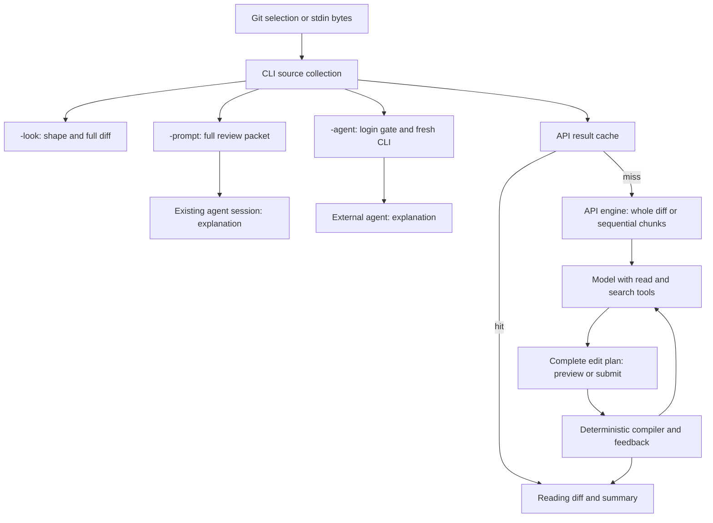

# System design: evidence an agent can navigate and control

Status: design direction, 2026-10-05. The **current system** below is verified
against source. The **target system** is proposed work tracked in the
[roadmap](roadmap.md); its contracts live in
[agent interface](../specs/agent-interface.md). Those proposals add no commands
or guarantees to today's CLI.

## The job of the system

Meat helps a reviewer spend attention on consequential changes while preserving
a route back to the evidence. Its success depends on three things together:
correct scope, faithful transformation, and an honest account of what remains
unknown. A shorter diff alone measures none of those completely.

An agent should be able to answer, with little investigation:

1. What outcome was requested, and which exact change am I examining?
2. What evidence do I have, what can I inspect next, and what is unavailable?
3. Which operation will answer the remaining question at the lowest cost?
4. What did that operation establish, omit, spend, or fail to establish?
5. What can another session reuse, and what must it verify again?

Optimize the total cost of reaching a supported conclusion: model calls,
repeated context, local I/O, elapsed time, and human attention. Prefer a local
deterministic answer when it resolves the question. Spend additional reasoning
where uncertainty could change the review.

## Where to read and which document owns the answer

| Question | Owner | Authority |
|---|---|---|
| What can I run now? | [README](../README.md), [workflow](agent-workflow.md) | Current usage |
| What code owns this behavior? | [AGENTS](../AGENTS.md), [spec index](../specs/INDEX.md) | Navigation and invariants |
| What is implemented and constrained? | [Subject specs](../specs/README.md), linked source and tests | Current contracts; Go sections identify the frozen baseline |
| How should the whole system fit together? | This document | Design direction |
| What will future agent-facing operations promise? | [Agent interface](../specs/agent-interface.md) | Proposed contract, explicitly unimplemented |
| What should be built next and how will we know it works? | [Roadmap](roadmap.md) | Dependency order and acceptance gates |
| Why does a maintained choice exist? | [Decisions](decisions.md) | Verified rationale, evidence, revisit condition |
| How was the port performed? | [Migration](../migration/README.md), [old ledger](../TODO.md) | Historical evidence |

Source shows actual behavior; tests constrain particular cases; specifications
state the intended contract. When they disagree, record the discrepancy and
resolve it in the owning change. A proposal cannot silently override a current
contract, and a historical instruction cannot select today's task.

Read progressively: start with the task's owner, follow its relevant links, and
open deeper implementation details only to resolve a question. Keep startup
instructions small enough that this routing remains useful.

## Current system

All paths share diff collection in [main.ts](../src/cli/main.ts). They produce
different artifacts. [prompt.ts](../src/cli/prompt.ts) preserves the full input
and hashes its bytes. [agent.ts](../src/cli/agent.ts) runs a fresh subscription
review. [meat.ts](../src/meat/meat.ts) asks an API model for edit plans and
compiles them locally. The default CLI path is API abridging; the meat skill
defaults explanation requests to the current session's packet workflow.

The compiler validates source-derived edits and specified structure, including
mandatory import removal and applicable move symmetry. It does not establish
semantic completeness, summary accuracy, passing tests, or patch applicability.
The rubric's assumptions about compiling code and passing tests are assumptions,
not test evidence. See [editplan](../specs/editplan.md) and
[rubric.ts](../src/meat/rubric.ts).

The main gaps are connections between these paths:

| Current observation | Consequence | Proposed owner |
|---|---|---|
| Source is diff bytes plus a label; packet adds byte hash | HEAD can move; a hash alone does not identify surrounding source | Evidence snapshot |
| Engine tools read the live checkout | Historical or staged changes can be interpreted using different source | Context policy |
| Look and packet both print the full diff | Neither provides a bounded entry point for a large review | Inventory and evidence selection |
| Result exposes diff, summary, token totals | Fallback, chunk handling, validation coverage, and usage uncertainty are hidden | Run receipt |
| Limits restart for each engine chunk | Per-run bounds do not express a whole-review budget | Execution controller |
| Cache key contains rubric, model, diff | Changed context or provider routing is outside cache identity | Evidence-aware reuse |
| Historical ledgers previously dominated plan discovery | Obsolete work could be resumed | Resolved by P0: current roadmap and authority map |

Evidence: [CLI source collection](../src/cli/main.ts),
[tools](../src/meat/tools.ts), [shape](../src/cli/shape.ts),
[engine](../src/meat/meat.ts), [chunking](../src/meat/chunk.ts),
[cache](../src/cli/cache.ts). Detailed current limitations remain in their
subject specs.

## Target system: a linked sequence of artifacts

The following layers are proposed. Each adds meaning while retaining references
to the evidence beneath it. Implement them as small values and functions around
the existing CLI and engine; introduce a separate module when ownership or
multiple consumers justify it.

| Layer | Artifact and question answered | Depends on |
|---|---|---|
| Intent | Review request: desired outcome, source selection, permitted execution, resource limits | User's task |
| Evidence | Snapshot: exact diff bytes, resolved source, available context and its identity | Source collection |
| Orientation | Inventory: files, hunks, sizes, unsupported content, relationships and coverage | Snapshot |
| Control | Execution plan: selected evidence, workflow, context policy, partitions, enforceable limits | Request and inventory |
| Execution | Run receipt: outcome, evidence used, costs, limitations, recovery options | Plan and actual operations |
| Result | Raw view, review packet, compiled reading diff, or explanation with its own guarantees | Snapshot and receipt |
| Learning | Maintained decision or regression case with evidence and a revisit condition | Verified outcomes |

An execution plan is distinct from the compiler's **edit plan**. The former
chooses work; the latter proposes complete remove/replace/fold operations in
original diff coordinates. A packet is review input. An explanation is an
interpretation. A receipt records what happened, including a run with no usable
result.

A request can produce more than one result: an agent may explain a compiled
reading diff while linking back to omitted source. The explanation inherits
references to its inputs, never an automatic claim of compiler or semantic
validation.

### One operating loop

Observe the inventory, select the smallest sufficient evidence, choose an
operation, execute within its limits, inspect its receipt, and resolve the
remaining material uncertainty. Stop when the requested outcome is supported
or a specific evidence/resource boundary prevents it. Record that boundary.

The first observation should be cheap and bounded. Expansion should target a
file, hunk, side, or relationship by stable identity. Every omitted or truncated
region needs a discoverable continuation or explicit unavailable status.
Partitioning a review changes its coverage obligations: preserve a manifest of
the parent selection and inspect dependencies that cross partitions.

New requests should reuse a captured snapshot and useful deterministic
derivatives. They should not repeatedly dump the same full diff, rebuild an
unchanged inventory, or re-run an already validated compiler plan.

### Example: reviewing a historical branch

In the target system, an agent is asked to explain a branch against its actual
base while the local worktree contains unrelated edits:

1. Resolve the branch, base and merge base once; capture the diff and immutable
   context trees. The dirty checkout is a separate source of evidence.
2. Read a bounded inventory. Expand a changed function, its callers and a moved
   block because those relationships could change the explanation.
3. Use the existing session if explanation is the requested outcome. If a
   compiled reading diff is requested, forecast the selected chunks and execute
   under a whole-request allowance.
4. Inspect the receipt: a retained fallback is labelled, any unenforced move
   pair is visible, and unobserved external-agent coverage stays unobserved.
5. When the user changes the branch, compare evidence identity before reuse.
   Reuse compatible deterministic work; invalidate context-dependent findings.
6. Hand off the resolved scope, inspected coverage and unresolved question.
   Promote a reproduced general lesson into the owning contract or decision.

This scenario joins the layers without making every review pay for every
operation. A small packet explanation can end after sufficient evidence is read;
a large interrupted abridgment benefits from explicit coverage and recovery.

### Ownership and dependency direction

| Boundary | Owns | Receives from adjacent layers |
|---|---|---|
| CLI and skill adapters | Intent mapping, launch, presentation | Common request/result contracts |
| Source and context adapter | Git/stdin collection, snapshot reads and search | Explicit selection and context policy |
| Deterministic analysis and compiler | Byte coordinates, inventory, partition maps, edit-plan validation | Immutable evidence and policy versions |
| Execution controller | Scheduling, aggregate limits, cancellation, attempt accounting | Plan and adapter capabilities |
| Model/provider or external CLI adapter | Its protocol, auth, transport, observable usage | Bounded operation request |
| Artifact store | Identity, validation on load, cache/checkpoint lifecycle | Versioned artifacts and dependency identities |
| Knowledge maintenance | Evidence promotion and stale-entry review | Human-readable findings and reproducible cases |

The compiler stays usable offline, without Git, credentials, model access, or
knowledge storage. Renderers consume recorded results. Skills select workflows
and explain evidence using the same contracts. Backend adapters declare which
controls and observations they actually support.

## Guarantees an agent can reason about

- **Identity before interpretation.** Every derived artifact identifies its
  input. A ref name, diff digest, context snapshot, and execution attempt answer
  different questions; retain each where applicable.
- **Evidence before authority.** Diff content, commit messages, source files,
  and stored findings are data. A retrieved instruction does not acquire the
  user's authority. Claims cite the evidence actually inspected.
- **Coverage before completion.** Account for the selected input, including
  omitted imports, passthrough sections, unsupported content, and unfinished
  partitions. State separately which relationships received validation.
- **Observable limits.** Distinguish hard limits, estimates, best-effort controls,
  and unavailable measurements. Failed attempts can cost money even when usage
  is unreported. Unknown usage stays unknown.
- **Recoverable failure.** An error identifies the failed operation, retained
  evidence, and useful next step. Retry only when new evidence or a transient
  condition gives a reason; charge retries to the same resource budget.
- **Reuse with validity conditions.** Cache entries and checkpoints identify
  their evidence, policy and protocol. A prior success cannot prove current
  checkout facts, and an incomplete candidate cannot masquerade as completion.
- **Learning with evidence.** Promote a repeated lesson into the smallest
  appropriate contract, regression case, workflow rule, or decision. Preserve
  its scope and invalidation conditions.

The [proposed interface](../specs/agent-interface.md) turns these principles into
specific obligations, including failure and compatibility behavior.

## Two loops for accumulating useful knowledge

The review loop produces a bounded artifact: scope, supported findings, open
questions, actual verification, and remaining coverage. Future sessions can
continue from it after checking identity.

The maintenance loop promotes durable findings. A concrete failure gets a
reproduction and, when behavior is changed, a focused regression test and
contract update. A stable design choice gets rationale, evidence and a revisit
condition in [decisions](decisions.md). Correct or supersede stale entries in
place. The [workflow](agent-workflow.md) owns the handoff procedure.

Store operational artifacts under an explicit local retention policy; keep
curated knowledge in version control. Keep generated transcripts, speculative
conclusions, credentials, and provider reasoning state out of maintained
knowledge. Model-authored conclusions require verification before promotion.
Changes to the rubric or compiler follow normal review and protocol-version
rules; accumulated notes alone never alter them.

## Measuring whether this design helps

Use a fixed set of offline cases covering small changes, historical revisions,
dirty staged reviews, oversized diffs, cross-chunk moves, cache reuse, and
interrupted execution. Measure:

- Time and output bytes to identify scope and choose a useful next operation.
- Model calls, transport attempts, returned context bytes, elapsed time, and
  reported usage, with unavailable measurements visible.
- Coverage accounting and reproducible navigation from result back to raw input.
- Ability to detect stale evidence, distinguish fallback from completion, and
  continue valid work without repeating completed operations.
- Consequential facts retained and unsupported claims introduced, assessed
  against case-specific evidence by reviewers.

Treat compression ratio as descriptive. It cannot substitute for retaining
consequential facts. Establish the baseline before claiming savings; keep live
model evaluations explicit, separately costed, and outside ordinary checks.
